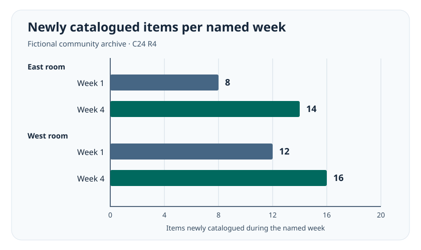

# Chapter 9 — Operate multimodal workflows
*Read the evidence once. Check what survived the change of form.*

Imagine a community archive publishes a chart of items it catalogued. A volunteer gets the chart as an image and a separately prepared text description. The chart shows the West room going from 12 to 16. The description says it went from 12 to 18. An assistant produces a smooth sentence: “West finished at 18, four more than it started with.” It has put a number from one representation next to a difference from another. The sentence sounds like a summary. It's really a receipt for a disagreement nobody noticed.

The problem isn't that images are unreliable and text is trustworthy, or the other way round. The two describe the same chart only if they agree about its version, labels, units, and values. A text alternative can make a chart usable without seeing it. It can also make an old mistake very easy to read. A scan can show the exact mark someone made, but it might not show which marks are current, who wrote them, or whether a section of the page was cut off. Read each representation according to what it can establish. Don't give authority to the one that arrives in the neatest package.

The easiest system to build takes everything at once and asks for an answer. The easiest system to check is different. It first asks what the evidence visibly says, then compares those observations with a human-verified account and the task's source rule, then permits only claims that survive. The pause between seeing and deciding costs work. It also tells the next reviewer which part failed. A missed axis label, a stale transcription, and an invented value should not produce one diagnosis named “model error.”

**After this chapter, you can:**

1. Specify which form supplies which kind of evidence, and check that all forms describe the intended item and revision.
2. Separate an unverified description from a human-verified one, reconcile concrete discrepancies, and leave unreadable values unknown.
3. Compare the same decisions across a visual input and an accessible text alternative without changing the rules.
4. Write release, monitoring, stop, and rollback criteria for a bounded draft workflow and explain what the evidence doesn't prove.

The two cases below are fictional paper exercises. Diagrams, descriptions, candidate answers, and traces are authored fixtures, not images captured from a real archive or results produced by a model. No account, software integration, transfer, booking, publication, or real operational change is part of the exercise.

## Keep the three descriptions apart

A *modality* is a form of input. Here we care about visually arranged marks and written text. Text may be adjacent to an image, embedded in it, extracted from it, or authored separately. These sources can be related without being interchangeable. Think of a hand-drawn circle around a quantity. A transcription with the number but no circle may accurately copy the characters and fail to preserve the important meaning. A description that says “one number is circled” may preserve the cue without giving the number. Both are still incomplete for a task that requires identifying the circled quantity.

Keep three records separate:

| Record | What it contains | What it cannot settle alone |
| --- | --- | --- |
| Source item | The chart or scan and known identifying information | Whether a small label was readable to the particular reader, or which artifact is approved for this use |
| Candidate observation | What a reader, software extractor, or model says it sees, with locations and unknowns | Whether those readings are correct or whether the observation is authorized as final evidence |
| Verified representation | A named reviewer’s checked equivalent of task-relevant content, tied to the same item and revision | What was cropped, what a source never supplied, or authorization to publish or act |

Verification doesn't turn a guess into an observation. When the reviewer finds an unreadable field, the verified representation should keep it unreadable. When a separate authoritative record clarifies the value, cite that record and say it resolved a previously unreadable field. Don't retroactively claim it was legible on the image. A truthful account preserves the difference between reading a value and obtaining it elsewhere.

The order matters. If a reviewer first sees a candidate reading of “18,” they may look hardest for a way the mark could be 18. For consequential fields, ask the reviewer to make an independent observation before consulting the candidate, when practical. Record the location or label that supports each reading. Compare observations afterward. A second person or an approved structured source can help resolve a disagreement; their authority comes from the task's rules, not from being the second thing you asked.

### What to put in the prompt

A compact observation prompt for these exercises is:

> Describe the task-relevant marks before answering. For each requested field, give the artifact revision if supplied, the location or label, the visible value and unit, and a reading state of *visible*, *unreadable*, or *absent from the supplied view*. If a value is estimated, label it an estimate and don't use it as an exact value. Don't correct a mark or supply missing digits from context. Next compare the candidate observations with the dated, human-verified text representation if it is available. Report disagreements with both observations intact. Give the requested conclusion only when the stated source rule and required fields support it. Return a draft for review; do not send it or change anything.

The prompt helps organize the answer. It does not verify the answer. The review process needs its own source inspection and tests: wrong units, crossed row labels, a value guessed from neighboring rows, and an outdated text alternative. If two forms disagree and the system simply picks the higher-confidence one, it hasn't applied the source rule. It has replaced the rule with a preference for confident presentation.

An observation state is not a decision state. A field can be *visible* while the conclusion is *hold for conflict*. A field can be unreadable and the conclusion can still be valid if the task doesn't depend on it. Define required fields first. This keeps the reviewer from averaging away a missing required number or blocking a supported claim because a decorative part of a scan is unclear.

### Put accessibility in the comparison, not in a footnote

[WCAG 2.2 Success Criterion 1.1.1, Non-text Content](https://www.w3.org/TR/WCAG22/#non-text-content) calls for a text alternative that serves the equivalent purpose for non-text content, with specified exceptions. The [W3C WAI complex-images tutorial](https://www.w3.org/WAI/tutorials/images/complex/) illustrates how charts can use a concise description and a longer equivalent, including a table when detailed values are important. A label that says “bar chart” tells a reader what sort of object exists. It doesn't let them compare two rooms' counts. If comparison is the chart's purpose, provide the values, labels and units needed to make it.

Write the chart's brief identification and the equivalent data together. Use headers that explain what each row and column represents. Carry over important scope notes, such as asterisked exclusions or differing time windows. Where relative placement matters, describe the relation in words instead of making a reader infer it from ordering that may not be apparent in their interface. Invite a reader to make the decision independently from the equivalent text, not merely answer whether the text looks like the chart.

Do not call the whole workflow conformant because one chart has a table. This exercise tests whether the text preserves information for a task. Actual page structure, navigation, and how the content behaves with assistive technology need separate checks. Don't make a less reliable “accessible path” that bypasses verification. A nonvisual reader deserves an equivalent supported conclusion, including the same uncertainty when the evidence is genuinely missing.

<!-- → [INFOGRAPHIC: one source item feeding the candidate observation and independently verified text; both face the same decision rule and hold outcomes] -->

## Worked example 1: the chart with the wrong ending

The fictional catalog lead requests a draft sentence identifying which room’s **number of newly catalogued items** increased more from Week 1 to Week 4. This is a count over each named week, not a cumulative collection total. The contract calls for an exact change for each room and a comparison of the two changes. Exact values must come from readable printed labels or a same-revision reviewer-verified table. If a required label or value disagrees with supplied text, hold that result until reconciled. The reviewer cannot publish the sentence from this exercise.

### Step 1: record the visual evidence



The equivalent text map below is another way to read the **invented graphic**. One block represents one item and the printed values are included as fields. It is deliberately redundant so a reader can complete the same independent check without the image.

```text
Archive intake chart C24, revision R4
Measure: items newly catalogued in one named week
East, Week 1:  ########           printed value 8
East, Week 4:  ##############     printed value 14
West, Week 1:  ############       printed value 12
West, Week 4:  ################   printed value 16
```

Start without the candidate description. Point to each room-and-week combination and record its exact label. You get East (8, 14) and West (12, 16). The units are items. The artifact describes newly catalogued items; there's no basis for interpreting 16 as the whole West collection. The phrasing “from Week 1 to Week 4” requests a difference between these two observations, not a total across four weeks. No Week 2 or Week 3 counts are supplied.

### Step 2: find the discrepancy instead of smoothing it

Suppose the first accompanying text says: “East 8 to 14 and West 12 to 18,” and its source line says C24 without a revision. An early candidate says that the rooms both gained six. The arithmetic is internally consistent with that text: `14 − 8 = 6`, and `18 − 12 = 6`. It's wrong for the observed R4 chart. This is a useful failure because a simple arithmetic check would pass. The missing revision also prevents treating the text as a checked equivalent of the chart.

| Field | R4 graphic map reading | Unverified text reading | Disposition |
| --- | ---: | ---: | --- |
| East, Week 1 | 8 | 8 | Values agree; compare against verified equivalent |
| East, Week 4 | 14 | 14 | Values agree; compare against verified equivalent |
| West, Week 1 | 12 | 12 | Values agree; compare against verified equivalent |
| West, Week 4 | 16 | 18 | Conflict; withhold room comparison |
| Revision | R4 | Not specified | Text is not eligible as same-revision proof |

Do not settle the conflict by silently replacing 18 with 16 in the old description. That loses evidence about what arrived and makes it impossible to tell if the accessibility channel initially presented the wrong value. The fictional reviewer independently inspects the four print labels, checks the chart ID and revision, and signs off on a **new** text equivalent, explicitly tied to R4. For the exercise that equivalent is:

> **C24 R4. Newly catalogued items per named week.** East: Week 1, 8 items; Week 4, 14. West: Week 1, 12 items; Week 4, 16. Weeks 2 and 3 are not represented. The comparison is between the two named weeks, not a total of the collection.

| Room | Week 1, items | Week 4, items |
| --- | ---: | ---: |
| East | 8 | 14 |
| West | 12 | 16 |

The fictional source owner now marks the earlier text unsuitable for this version; it remains in the discrepancy record. Both verification and source status are needed. A new table copied automatically from the candidate would not have supplied an independent check.

### Step 3: compute the requested result along both paths

Define change as the Week 4 count minus the Week 1 count for the same room. East gained `14 − 8 = 6` items. West gained `16 − 12 = 4`. East gained two more items than West over the comparison, because `6 − 4 = 2`. West still had the higher Week 4 count. Bigger endpoint and bigger increase are different comparisons. No percentages are needed for this task; using percentage growth would change the question.

A supported draft is: “East’s weekly count rose from 8 to 14, an increase of 6 items. West’s rose from 12 to 16, an increase of 4 items. East’s increase was larger by 2 items.” Check the same result from the verified table alone. Equivalent doesn't mean identical phrasing; it means the decision and supporting facts survive a change of form.

If the Week 4 West label is cut off in a copy, recalculate what the **new supplied evidence** permits. East's change remains supported. West's exact change needs the verified R4 equivalent whose identity is securely matched to that copy. Without that equivalent, the headline comparison stops. “It looks shorter than the East bar” would not establish an exact value, and height alone would not always establish a change without aligned axes and readable labels. The chapter doesn't ask you to guess those circumstances from the fixture.

## Worked example 2: a scan, a transcript, and a separate ledger

The fictional archive reads an inventory intake slip to draft an internal review note. The slip for Box Q is revision S2. A typed draft transcript is labeled S1. There is also a verified intake ledger entry L7, whose authorized scope in this case is the recorded **number of accepted items**, not text on the slip. The exercise contract asks for the box ID, accepted item count, and a storage shelf only if independently legible on the current slip. An exact count is required. Shelf is optional: if unreadable, report it as unknown and do not assign a shelf. Don't update the ledger, replace the transcript, or transfer anything.

These are the stipulated representations. Brackets in the scan map describe missing visual information; they are not characters on the slip.

| Field | Current scan map S2 | Draft transcript S1 | Independently verified ledger L7 |
| --- | --- | --- | --- |
| Box | Q | Q | Q |
| Accepted items | 2[unreadable last digit] | 26 | 28 for Box Q |
| Shelf | B-[unreadable mark] | B-6 | Not recorded |
| Identification | Slip intake box Q, current S2 | Same box, prior draft S1 | Same intake, verified count entry |

### Step 1: observe without filling the spaces

On the scan map, Q is visible. The accepted-items field begins with 2; its last digit isn't readable. Nothing says whether the missing digit is 6, 8, or something else. The shelf appears to begin with B-; the final mark isn't readable. A faithful text representation of the image says exactly that. It shouldn't say “28 items” at this step. Even if that turns out to be the ledger count, it wasn't read from the image.

Suppose a candidate drafts: “Box Q contains 26 accepted items, stored on shelf B-6.” Both exact values came from a prior transcript. The count contradicts the verified ledger. The shelf lacks independent support on S2, and “stored” implies that a placement occurred. The lesson isn't “never use an old transcript.” It is that an old draft can reveal what was once written down without establishing what the current slip says. The text-only candidate failed two source tests and made an unsupported statement about state.

### Step 2: use the right authority for each field

The exact count is **28 according to L7**, which is identified for the same box and intake. It is a ledger observation, not a newly legible slip reading. The shelf remains unknown under the rule: no ledger shelf, no legible shelf mark on the current slip, and no permission to use S1 as a fallback. The current scan and ledger agree on Box Q. We have enough to draft a **partial note**:

> Box Q. The verified intake ledger L7 records 28 accepted items. The current slip S2 does not establish the shelf: the final mark is unreadable. The older transcript S1 differs on count and was not used for the current note. No shelf is assigned.

Unlike the chart, this task doesn't require every field to be settled for a useful draft. A shelf is explicitly optional. If the decision were “return the item to its verified shelf,” the unknown would be a full stop rather than a note. That change is in the task, not a reason to take a more confident guess.

### Step 3: verify the language the next person receives

Give a reader only the verified text alternative of S2 plus the identified ledger excerpt. Their conclusion should still be 28 **from L7**, with shelf unknown. A reader given only the verified S2 alternative should report the count as unresolved and hold the note because a required field is missing. That isn't an accessibility defect: S2 didn't establish the value visually either. Sending the verified transcript without L7 while sending L7 to the image condition would not make a fair comparison. The conditions would have different evidence.

Preserve this decision trace:

| Claim | Support and scope | Outcome |
| --- | --- | --- |
| Box is Q | Current slip S2 box field and matching ledger identity | Supported |
| Accepted count is 28 | L7, authorized for count only | Supported for the draft; not transcribed from S2 |
| Shelf is B-6 | Older S1 only; S2 shelf mark unreadable | Withheld |
| Box was moved | No source or action in the exercise | Not claimed |

A quiet success here is refusing to make the evidence look more complete than it was. Treat the partial note as a properly handled case, not a failure to finish the sentence.

## Release, monitor, and roll back to a known state

These steps are a design review for a hypothetical **draft-only** service, not an account of a deployment. Start with paired examples and record the source rule before comparing versions. For each artifact, use the same task, same evidence access and equivalent independent reviews in the image and text conditions. Judge factual fields, units, source attribution, abstentions, and draft boundaries separately. A correct number with the wrong source fails the attribution check. A correct hold on an unreadable required field passes. Record unavailable inputs as their own outcome rather than counting them as right or quietly deleting them.

Build the comparison panel around cases that expose differences: fully readable chart; chart with a cropped label; same-revision verified table; older table with one wrong number; scan with unreadable optional field; scan without required count support; scan with a separate eligible count source; and disagreement about the artifact ID. A reviewer records the expected decision before seeing outputs. A fixture is an intentionally chosen test with known properties, not a random sample of archive work or evidence of rate in the wild.

Suppose the paper exercise marks eight cases. In the image-input path seven satisfy the contract. In the text-input path six do. The missing successes matter more than the two fractions: say the image path uses one wrong week label, while the text path accepts one obsolete transcript and guesses one cropped amount. Retaining case identifiers reveals where those failures occurred. Here is the complete fictional scorecard:

| Fixture | Expected handling of the relevant evidence | Image path | Text path |
| --- | --- | --- | --- |
| C1 · Fully readable chart | Produce both changes with units and dates | Pass | Pass |
| C2 · Cropped label; no verified equivalent | Hold the exact comparison | Pass | Fail: guesses the missing count |
| C3 · Verified equivalent with named week windows | Preserve the distinct week labels | Fail: uses the wrong week label | Pass |
| C4 · Older table with one wrong number | Preserve disagreement; do not treat it as verified | Pass | Fail: accepts old table |
| C5 · Unreadable optional field | Keep unknown and use supported required fields | Pass | Pass |
| C6 · Unreadable required count; no eligible ledger | Hold the draft | Pass | Pass |
| C7 · Eligible ledger supports count only | Attribute count to ledger; do not infer shelf | Pass | Pass |
| C8 · Artifact IDs disagree | Stop and ask for matching input | Pass | Pass |

The paths agree on five cases: both pass C1 and C5 through C8. Exactly one passes the other three. Counting only net successes makes that disagreement appear to be one case instead of three. If critical invented-value, stale-source, and unauthorized-action cases must be handled correctly in both paths, the guessed count in C2 and acceptance of the old table in C4 are already enough to stop. This panel does not test every critical category; a trial plan still needs an explicit boundary fixture for claims of action. “Five cases agreed” doesn't rescue a release rule that forbids a specific error.


### Decide in advance what will stop a draft

| Gate | What evidence is needed | If evidence is missing or adverse |
| --- | --- | --- |
| Before anyone relies on draft outputs | Independently reviewed fixtures; matching version IDs; equivalent available evidence; critical holds and draft boundaries pass in both paths | Keep notes out of the response channel used for ready drafts; use manual review |
| During an approved limited trial | Separate observations by source type, artifact version, template, and input quality; sample reviews of both supported and held cases | Pause the affected path on an unverified exact field, role confusion, or a revision disagreement affecting a required claim |
| After a change in inputs or templates | Fresh paired cases that include the new conditions; comparison against retained prior evidence | Do not assume success transfers; keep new cases in review until the condition is understood |
| After a stop | Known trustworthy prior path and still-compatible evidence, or a documented manual fallback; reviewed reason and scope | If no trustworthy path remains, keep automation stopped |

Choose what to count: for example, number of candidate values inspected, number with attached eligible evidence, number unavailable or held, and number that disagree with independent observation. Each denominator says what work was examined. Review the frequency and reasons, not just a headline pass rate. If most new scans come from a photocopy format whose marks are smaller, the conditions changed. That is *input drift*, even if the policy didn't. If staff make the ledger the source for a different field, the *decision policy* changed. If an image renderer starts cutting off the last column, the *presentation* changed. Classify the change so the next test recreates the condition instead of assigning blame to the model by default.

Rollback means returning to a known safe workflow, not rewinding reality. Restoring the last tested draft template doesn't make an outdated chart current. Check the prior baseline against the current source revisions before reusing it. Where no compatible baseline exists, choose a verified manual path or keep the workflow stopped. Preserve affected draft IDs and evidence revisions; don't overwrite earlier outputs with corrected ones and pretend nobody saw the old output. On paper, decide who would need to review affected drafts and which cases should re-enter evaluation. Nothing here sends such a notice or constitutes permission to send one.

### A trace that helps another person decide

For each reviewed case, write only what is necessary to explain the decision: task and contract revision; artifact ID and input form; location and support for required fields; whether the text equivalent was independently verified; disagreement or missing reason; draft status; and which human review took place in the exercise. Keep derived values and estimates labeled. A record of “verified” without a link to the artifact revision or review basis is a green sticker, not evidence. Avoid storing unrelated contents from a scan. Even a read-only task can expose information if its logs retain everything the source showed.

A usable stop explains the next move in the terms of the task: “Latest chart and text disagree on West's final count; comparison withheld until the source owner verifies an R4 equivalent.” It doesn't say “failed; try again,” which invites repeating the same unresolved evidence. It also doesn't write “fixed” when nobody reviewed the replacement. The best operational fix often changes what reaches a reviewer and how the reviewer sees the two forms, rather than adding a stronger instruction at the end of the prompt.

## Exercises

**Warm-up**

1. **Separate observation from decision.** In the chart case, record one visible label, one arithmetic claim and one draft state. For each, identify what kind of evidence supports it and what would falsify it.
2. **Keep missing distinct from zero.** A text table shows a dash in an unlabeled cell. Give two possible interpretations other than zero. State the wording you would retain until the table's notation is verified.
3. **Give a text equivalent.** Draft a one-sentence identification and a three-column data table for the chart. Ask a partner to compare the two changes using only your text, then identify any titles, time windows, units or values they had to infer.

**Application**

4. **Change one required field.** Remove the Week 1 East label from the chart copy and mark the accompanying table not yet verified. State which comparisons remain possible, what cannot be computed exactly, and which evidence would change the result.
5. **Correct the count, not the scan.** Use the Box Q case but make L7 describe a different intake for the same box. Write an observation, an admissibility decision, and the current draft status. Don't use the older transcript to fill the gap unless you also explain a new source rule and who would have to approve it.
6. **Expose mixed-source arithmetic.** Make a candidate give East +6 and West +4 but say West ended at 18. Design one numeric consistency check and one independent source check. Explain why a candidate that passed the first test could still fail the second.

**Synthesis**

7. **Build paired controls.** Pick a fictional archive chart containing labels or footnotes that affect a decision. Make matched image-map and text inputs, define expected field values and holds before comparing, and interchange the order of the inputs. Name one metadata difference that could otherwise explain a disagreement.
8. **Plan a bounded trial.** Write gate and stop criteria for both forms, including a stop for one invented value on a required field. Include a plan to review correctly held cases as well as apparently successful ones. Specify exactly what your measured denominator does and does not represent.
9. **Judge a rollback.** An old observation form passed all earlier paper fixtures. A new edition of the slips omits the field it depends on. Decide whether restoring the old form is enough. Outline a fallback, affected case IDs, and evidence required before restarting the draft-only workflow.

**Challenge**

10. **Make a real disagreement inspectable on paper.** Prepare an alternative chart table that preserves all values but changes a column's time window, plus a scan transcript that preserves digits while swapping row labels. Have another reader discover the defects unaided. Design checks that catch them even if the resulting summaries are grammatical and arithmetically self-consistent.
11. **Defend a release refusal.** Write a short review note for a fictional sponsor who wants to continue after the image path passes every case but the text path silently accepts an old revision. Describe what would have to change for both paths to be valid and tell the sponsor how readers get an equivalent manual result in the meantime.

## What you can now do

You can split a multimodal workflow into observations, independent verification, and decisions. You can identify what was readable, preserve both sides of a conflict, bind each claim to evidence eligible for that specific claim, and distinguish an unknown value from a zero. You can use a verified text table to answer the same question as a chart without claiming that any convenient description is a checked equivalent. You can make a partial draft whose supported fields are useful and whose missing fields still look missing.

You can also design a stop before a reassuring sentence leaves the workflow. The conditions you review include access to equivalent evidence, format changes, revision identity, exactness, and action limits. When a new format changes any of those, you can explain why a previously valid decision doesn't automatically carry over. Your record should give another person a defensible next step, not just a confidence score.

Take the next proposal you review and ask which layer it changes: the source, the representation, the interpretation, or the release policy. Demand evidence appropriate to that change. A trustworthy workflow doesn't make every answer more confident. It makes it easier to see when a claim is warranted and easier to stop when it isn't.
